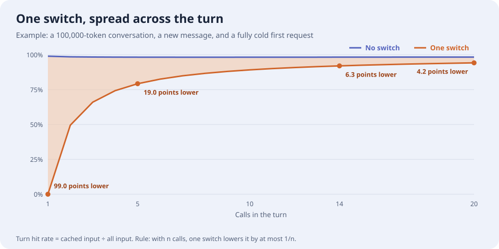
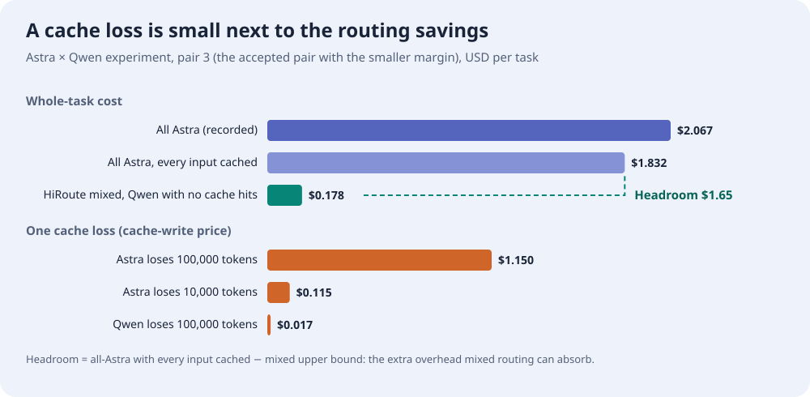
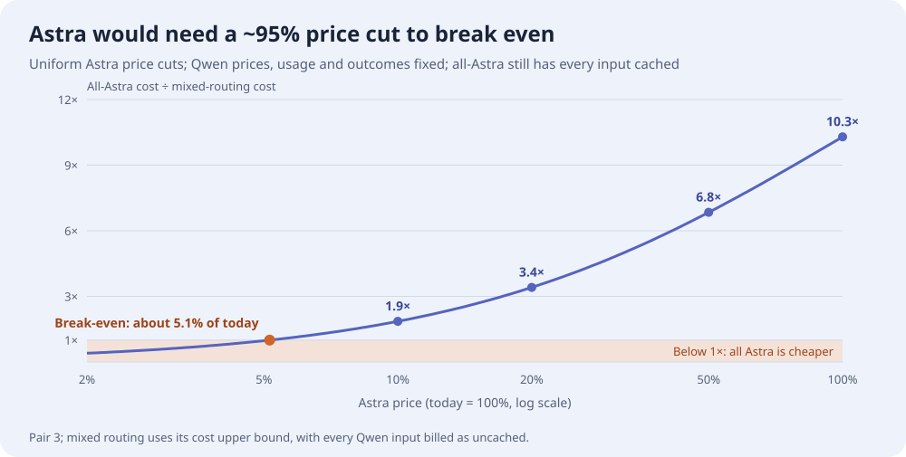

# Switching Models Loses Cache. Does Smart Routing Still Save Money?

Smart routing gives different work to different models. A natural question follows: once the model changes, the cache built up so far is no longer usable. Could that loss eat the money routing saves?

**Short answer: some cache is lost, but nowhere near enough to cancel the savings.**

- **Switches are rare to begin with.** HiRoute keeps the same model through consecutive tool calls within a turn, and only reconsiders at points such as a new user message or context compaction.
- **The loss happens once and gets spread out.** Only the first request after a switch misses the cache; later calls use the cache again. The more calls in a turn, the thinner the loss is spread.
- **The amount is limited, and direction matters.** Losing 100,000 tokens of cache on the primary model, Astra, costs at most about $1.15. Switching toward the cheaper Qwen actually lowers the cost of processing that old context.
- **The whole-task margin is large.** In the Astra × Qwen experiment, even if every all-Astra input token were billed at the cache price, mixed routing was still about 90% cheaper per task, leaving about $1.65 of headroom — roughly another 140,000 tokens of Astra cache rebuilding.
- **Even a steep primary-model price cut leaves the conclusion intact.** In this experiment, Astra would need a price cut of about 95% for the two approaches to break even.

The sections below walk through each point. Every figure can be recomputed with the [offline calculator](../experiments/cache_cost_analysis.py); the calculation basis is collected at the end.

## First: what does caching save?

Each time an agent calls a model, it resends the whole conversation: system instructions, tool definitions, earlier messages and tool results. The longer the conversation, the more content is repeated on every call.

KV Cache lets the model remember the beginning it has already processed, called the "prefix" below. When the next request starts the same way, the model reads the cache and charges the cache-read price, typically around a tenth of the ordinary input price. On Astra, reading a million cached tokens costs $1; processing them normally costs $10.

Caches belong to a model. A model that has never seen this history must process it from scratch; only later requests can read its own cache.

So the cache loss from a switch means precisely this: **a prefix that could have been read at the cache price must be processed once at full price on the new model.** It is a one-time cost, not one repeated on every later call.

## How HiRoute reduces switching

HiRoute's context-hold mechanism, ContextHold, follows the rhythm of the conversation to decide when a model change is allowed:

| When | What HiRoute does | Effect on caching |
| --- | --- | --- |
| Consecutive tool calls within a turn | Reuse the choice already made for the turn and keep the current model | No switch; the cache keeps growing with the conversation |
| A new user message | Reassess the task; keep or change the model | Keeping it loses nothing; changing it loses the old prefix once |
| After compaction or a history rebuild | Keep the choice if it still applies; otherwise reassess | Part of the history must be rebuilt anyway, so switching adds less |

Most calls in a turn are tool round-trips, and these do not change models. In one unattended coding run of 40 requests, 35 reused an existing choice directly, or 87.5%.

Whether a request actually hits the cache also depends on the provider's caching rules and lifetime, and an unavailable model can still fail over to a backup. See the [model-routing guide](https://hiroute.ai/en/docs/model-routing/) for the rules.

## One switch, spread across later calls

Picture this: your conversation with an agent has reached 100,000 tokens, and you send a new message of about 1,000 tokens. Routing decides to change models, and the new model has never processed this conversation.

- **The first request after the switch:** all 100,000 tokens must be processed again, so this request's hit rate falls from 99% to 0. Seen in isolation, the loss looks large.
- **The tool calls that follow:** the new model now has this conversation cached and only processes the new tool results (say 2,000 tokens each time), matching the no-switch case.

In other words, the switch adds exactly one "100,000 tokens missed." Looked at across the whole turn, later calls dilute it:

| Calls in the turn | Hit rate without switching | Hit rate after switching | Difference |
| --- | ---: | ---: | ---: |
| 1 | 99.0% | 0% | 99.0 points |
| 5 | 98.3% | 79.2% | 19.0 points |
| 14 | 98.3% | 92.0% | 6.3 points |
| 20 | 98.4% | 94.2% | 4.2 points |

There is an easy rule to remember: **with n calls in a turn, one switch lowers the turn's hit rate by at most 1/n.** Five calls means at most 20 points; twenty calls means at most 5. The reason is simple: every call carries the old prefix, so the turn's input is at least n times that prefix, while the switch makes it miss only once.

How many calls does a real turn have? From the experiment records:

- **Drafting and reviewing:** 3–19 per turn, about 7 on average.
- **Long coding work:** a dozen or more in a row. In the final stretch of one HTTPX coding task, the same model handled 14 consecutive requests.

The case to watch is the reverse: **a long conversation, only one or two calls per turn, and frequent model changes.** The loss has nothing to spread across. If a turn switches several times, add up the loss from each switch.

## Switching after compaction loses less

When context grows too long, the agent compresses early history into a summary. After that, even the original model must process the summary and what follows, so that part is paid for whether or not the model changes.

What can still hit the cache is usually only the unchanged part, such as system instructions and tool definitions. Claude's [compaction and caching documentation](https://platform.claude.com/docs/en/build-with-claude/compaction-threshold#maximizing-cache-hits-with-system-prompts) describes this approach. Switching at that point therefore loses only this remaining prefix, not the whole history.

For example, in a stage that processes one million input tokens in total, a switch that loses a 100,000-token prefix lowers the hit rate by 10 points; if compaction leaves only 10,000 reusable tokens, the switch lowers it by just 1 point.

The two mechanisms do different jobs: **continuous execution reduces how often you switch, and switching at compaction reduces how much each switch loses.**

## In dollars: what one loss costs

The figures below use the frozen prices from the Astra × Qwen experiment, in USD per million tokens. Qwen's CNY prices are converted at a fixed exchange rate:

| Per million tokens | Astra | Qwen 3.8 Flash |
| --- | ---: | ---: |
| Ordinary input | 10 | About 0.12 |
| Cache read | 1 | About 0.015 |
| Cache write | 12.5 | About 0.19 |
| Output | 50 | About 0.40 |

The cache-loss calculation is direct:

> **Extra cost = lost prefix length × (first-processing price − cache-read price)**

Whether first processing is billed at the ordinary input or cache-write price depends on the provider. The examples below use the more expensive cache-write price as an upper bound:

- **Astra loses 100,000 tokens:** 100,000 × (12.5 − 1) ÷ 1,000,000 = **$1.15**.
- **Astra loses 10,000 tokens** (for example, only system instructions and tools left after compaction): **$0.115**.
- **Qwen loses 100,000 tokens:** under **2 cents**.

The cost is paid once. Spread $0.115 across twenty consecutive calls and each call carries under 0.6 cents, but the total is still $0.115. A long cached prefix is genuinely worth money, which is why HiRoute works to keep execution continuous.

### The direction of the switch changes everything

The figures above compare the same model with and without a cache. A real switch also involves the price difference between models. For the same 100,000-token old prefix:

| Direction | No switch: original model reads cache | Switch: new model processes again | Result |
| --- | ---: | ---: | --- |
| Astra → Qwen | $0.10 | About $0.019 | **About $0.08 saved** |
| Qwen → Astra | About $0.0015 | $1.25 | About $1.25 more |

Even processing from scratch with no cache, Qwen costs about a fifth of Astra's cache-read price. **Smart routing saves money mainly by moving work to the cheaper model, and in that direction the cache loss is close to negligible; moving up to Astra pays for stronger capability.**

## Back to the whole task: how much extra overhead fits

What ultimately matters is the bill for the whole task. In the [Astra × Qwen experiment](https://hiroute.ai/en/news/astra-qwen-smart-routing/), Qwen handled six source-verification components and Astra handled the critical decision, compared against using only Astra. In two of three paired runs, both approaches met the acceptance standard; the remaining pair's results are kept in full in the [experiment record](../experiments/cases/research-cost-quality/README.md).

| Run where both met the standard | Mixed routing | All Astra | Saving |
| --- | ---: | ---: | ---: |
| Pair 2 | About $0.147 | About $1.84 | 92% |
| Pair 3 | About $0.178 | About $2.07 | 91% |

Mixed routing uses its cost upper bound and all-Astra its lower bound, which works against mixed routing.

**Now give all-Astra the most favorable case:** assume every input token hits the cache and is billed at $1 per million. Each all-Astra run had about 116,000 input tokens and 34,000 output tokens:

- Input: 116,000 × $1 ÷ 1,000,000 ≈ $0.12
- Output: 34,000 × $50 ÷ 1,000,000 ≈ $1.71
- Total: about $1.83

| Run | All Astra, every input cached | Mixed routing | Still saved | Headroom |
| --- | ---: | ---: | ---: | ---: |
| Pair 2 | About $1.83 | About $0.147 | About 92% | About $1.68 |
| Pair 3 | About $1.83 | About $0.178 | About 90% | About $1.65 |

This comparison is deliberately lopsided: all-Astra hits the cache on every input, while Qwen in mixed routing never hits it at all (Qwen reported zero cache reads in the experiment, and the cost upper bound bills all its input at the more expensive cache-write price). Mixed routing is still about 90% cheaper. However good the cache, it only lowers input charges, not output. And Qwen's ordinary input price is already below Astra's cache-read price.

**Headroom** is how much extra overhead mixed routing can absorb before it stops being cheaper: about $1.65–$1.68 per task here. Compared with the earlier figures:

- Losing 10,000 tokens of Astra cache once costs $0.115, about 7% of the headroom.
- The full headroom equals roughly another 140,000 tokens of Astra cache rebuilding.

"Extra overhead" covers only cache rebuilding, routing decisions, or rework added beyond the experiment's recorded bill, so nothing is counted twice.

## What if Astra gets cheaper?

The conclusions above use the prices at the time of the experiment. Primary models often get cheaper, so how far would Astra's price have to fall before switching to Qwen stops paying off? The calculations below cut every Astra price by the same proportion and keep Qwen's prices, both approaches' token usage, and the delivery outcomes unchanged.

### One switch: up to an ~81% Astra price cut, switching saves money immediately

When switching toward Qwen, compare two prices: Astra's cache-read price for keeping the old prefix, and Qwen's first-processing price for rebuilding it. Today Astra reads cache at $1 per million tokens, while Qwen's first processing costs at most about $0.19. As long as Astra's price falls by no more than about 81% (to about 19% of today), switching is cheaper on the spot; there is no cache loss to recover at all.

Beyond that, a switch costs an up-front rebuild. After the switch, though, every call reads the old prefix from Qwen's cache, which is cheaper than reading it on Astra, so later calls earn the rebuild back. For a 100,000-token old prefix, counting only the cost of reading that prefix and ignoring other savings such as output:

| Astra price (today = 100%) | One-time extra cost of switching | Saved on each later call | Calls to pay back |
| --- | ---: | ---: | ---: |
| 100% | None; about $0.081 saved immediately | About $0.099 | Immediate |
| 20% | None; about $0.001 saved immediately | About $0.019 | Immediate |
| 10% | About $0.0086 | About $0.0085 | About 1 |
| 5% | About $0.014 | About $0.0035 | About 4 |

### Whole task: Astra would need a ~95% price cut to break even

Across the whole task, Astra's price would have to fall to about 5% of today — a cut of about 95% — before all-Astra matched mixed routing. And that is still the calculation most favorable to all-Astra: every Astra input is billed at the cache-read price, while mixed routing uses its cost upper bound with every Qwen input treated as uncached.

Why doesn't break-even require equal prices? At break-even, Astra's output price is about $2.6 per million tokens, still about 6.4 times Qwen's. But in this task, Qwen's six source-verification components produced about 160,000 output tokens, while all-Astra produced only about 34,000 for all seven components — Qwen wrote about 4.7 times as much. Part of the price advantage is offset by the larger volume.

> **Actual cost multiple ≈ price multiple ÷ usage multiple**

### A more general way to do the math

The example also suggests a way to judge any pair of models without relying on specific prices:

1. **Does the switch save money on the spot?** Compare the primary model's cache-read price with the economy model's first-processing price. If the former is higher, the switch has no cache cost.
2. **How soon does it pay back?** The one-time rebuild cost ÷ the amount saved on each later call gives the number of calls to break even.
3. **Is the whole task cheaper?** Compare what each model actually spends on the same work — price × actual usage — rather than the price alone. Whenever that difference exceeds cache rebuilding, routing decisions, and rework, smart routing saves money.

## Bottom line: keep the economy model working, upgrade when needed

HiRoute aims to let an economy model keep handling the work it suits, and bring in a primary model when stronger capability is needed. Complex work can start on the primary model, and weak economy-model performance can trigger an upgrade, avoiding repeated rework just to save on individual calls.

- **Keep the model stable within a stage** to accumulate cache benefits.
- **Reassess at rebuild points such as compaction** to avoid unnecessary cache losses.
- **Upgrade when needed** to protect the delivery standard.

**Smart routing has a total-cost advantage whenever savings from economy-model work exceed the added cache rebuilding, routing decisions, and rework.** In the experiment above, that gap is about an order of magnitude.

## Calculation basis

- **Prices:** the experiment's API-equivalent prices frozen on October 3, 2026, at the standard context tier. CNY is converted to USD at the fixed September 30 rate of `1.1355 / 7.6130`, calculated at full precision. These are historical analytical references, not current quotes or subscription bills. Original records are under `evidence.json → frozen_cost_basis` in the [frozen evidence archive](https://github.com/higress-group/HiRoute/releases/tag/experiment-evidence-2026-10-04).
- **Hit-rate example:** a token-weighted input hit rate, calculated rather than measured. It assumes identical input on both paths, a valid original cache, no cache at all on the new model's first request, and no further switches, compaction, or expiration. If the new model already holds part of the prefix, count only the difference; if a turn switches several times, add up each loss. The 87.5% figure measures decision reuse, not a cache-hit rate.
- **Call counts:** a turn runs from one user instruction to the end of that native Agent turn; a call is one business-model request. One response can contain several tool invocations, and routing-decision requests are counted separately. Writing counts come from the [per-turn structured records](../experiments/results/decision-routing-20261006/results.json) for Qwen 3.8 Max and GLM 5.3: 310 requests across 42 normally completed turns, median 5.5, mean 7.38, with 51 requests in six interrupted turns reported separately. HTTPX counts come from the [coding experiment](../experiments/cases/unattended-engineering/README.md): one instruction generated 40 requests (25 Qwen, 15 Astra), with two compactions, 30 accepted requests, and 10 cancellations. The final 14 consecutive Astra requests began with a reassessment after compaction; they show how long continuous execution can run, not a controlled new-user-message switch.
- **Switch-direction table:** it already includes the price difference between models, so the cache-loss amounts above must not be added again. New input, output, routing decisions, and rework still belong in the whole-task bill.
- **Whole-task costs:** these include all subject attempts, structural retries, and reported Jev decision costs. Some cache-write quantities were not reported and are treated as intervals, so the comparison uses the mixed upper bound against the all-Astra lower bound. Ordinary input, cache reads, and cache writes do not overlap; billed reasoning tokens are already included in output. The all-input-cached Astra cost keeps the observed output usage and is a fixed-usage sensitivity calculation. Savings are calculated at full precision and rounded down.
- **Price-cut analysis:** a hypothetical price-sensitivity calculation, not a new experiment. Astra's ordinary input, cache-read, cache-write, and output prices fall by the same proportion; Qwen prices, Jev decision costs, both approaches' token usage, and delivery outcomes stay as recorded. The whole-task break-even and figure use pair 3; pair 2 gives nearly the same result (about 5.15% of today). The per-switch payback table counts only reading a 100,000-token old prefix and bills Qwen's first processing at the cache-write price.
- **Figures:** generated by `experiments/render_figures.py` from the same frozen evidence.
- **Reproduction and scope:** recompute call counts, costs, and hypothetical comparisons with the [offline calculator](../experiments/cache_cost_analysis.py), following the [reproduction instructions](../experiments/README.md). The records support these specific workloads; a real task should be assessed with its own context length, call volume, and delivery quality.
