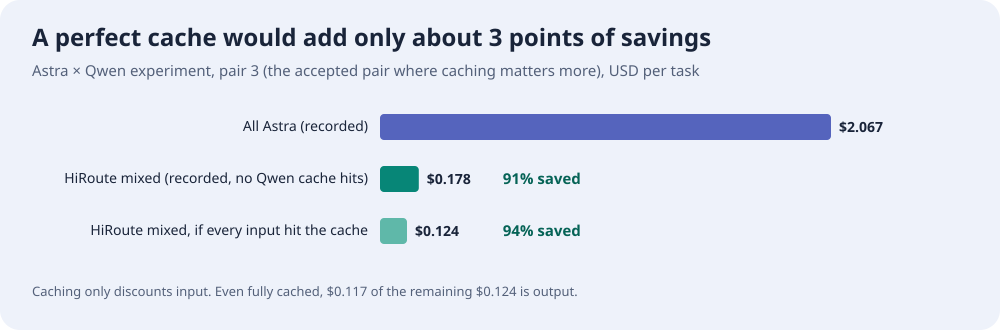

# Switching Models Loses Cache, Not the Savings

Smart routing gives different work to different models. A natural question follows: once the model changes, the cache built up so far is no longer usable. Could that loss eat the money routing saves?

**Short answer: some cache is lost, but nowhere near enough to cancel the savings.**

- **Switches are rare to begin with.** HiRoute keeps the same model through consecutive tool calls within a turn, and only reconsiders at points such as a new user message or context compaction. In one 40-request coding run, 35 requests simply kept the existing choice.
- **The loss happens once and gets spread out.** Only the first request after a switch misses the cache; later calls use the cache again.
- **Switching to a cheaper model can even lower the cost of old context.** A cheap model processing it from scratch often costs less than an expensive model reading its cache.
- **Caching moves the saving by only a few points.** In the Astra × Qwen experiment, mixed routing saved about 91% even though its Qwen calls hit no cache at all. Had every input hit the cache, the saving would have been about 94%.

HiRoute decides when switches happen, so you do not need to work out the math before turning on Smart saving. The sections below explain each point.

## First: what does caching save?

Each time an agent calls a model, it resends the whole conversation: system instructions, tool definitions, earlier messages and tool results. The longer the conversation, the more content is repeated on every call.

KV Cache lets the model remember the beginning it has already processed, called the "prefix" below. When the next request starts the same way, the model reads the cache and charges the cache-read price, typically around a tenth of the ordinary input price.

Caches belong to a model. A model that has never seen this history must process it from scratch; only later requests can read its own cache. So the cache loss from a switch is this: **a prefix that could have been read at the cache price is processed once at full price on the new model.** It is a one-time cost, not one repeated on every later call.

## How HiRoute reduces switching

HiRoute's context-hold mechanism, ContextHold, follows the rhythm of the conversation to decide when a model change is allowed:

| When | What HiRoute does | Effect on caching |
| --- | --- | --- |
| Consecutive tool calls within a turn | Reuse the choice already made for the turn and keep the current model | No switch; the cache keeps growing with the conversation |
| A new user message | Reassess the task; keep or change the model | Keeping it loses nothing; changing it loses the old prefix once |
| After compaction or a history rebuild | Keep the choice if it still applies; otherwise reassess | Part of the history must be rebuilt anyway, so switching adds less |

Most calls in a turn are tool round-trips, and these do not change models. In one unattended coding run of 40 requests, routing decided only at the start and around two compactions; the other 35 requests reused an existing choice directly, or 87.5%.

Whether a request actually hits the cache also depends on the provider's caching rules and lifetime, and an unavailable model can still fail over to a backup. See the [model-routing guide](https://hiroute.ai/en/docs/model-routing/) for the rules.

## One switch, spread across later calls

Picture this: your conversation with an agent has reached 100,000 tokens, you send a new message, and routing decides to change models.

- **The first request after the switch:** all 100,000 tokens must be processed again, so this request's hit rate falls from 99% to 0. Seen in isolation, the loss looks large.
- **The tool calls that follow:** the new model now has this conversation cached, matching the no-switch case.

The more calls in a turn, the thinner the loss is spread: **with n calls in a turn, one switch lowers the turn's hit rate by at most 1/n.** In the experiment records, drafting and reviewing turns averaged about 7 calls, and long coding work ran a dozen or more in a row.

The case to watch is a long conversation with only one or two calls per turn and frequent model changes, where the loss has nothing to spread across. HiRoute reconsiders only at new messages and compaction precisely to avoid that kind of back-and-forth.

## Switching after compaction loses less

When context grows too long, the agent compresses early history into a summary. After that, even the original model must process the summary and what follows. What can still hit the cache is usually only the unchanged part, such as system instructions and tool definitions (see Claude's [compaction and caching documentation](https://platform.claude.com/docs/en/build-with-claude/compaction-threshold#maximizing-cache-hits-with-system-prompts)).

Switching at that point therefore loses only this remaining prefix, not the whole history. **Continuous execution reduces how often you switch, and switching at compaction reduces how much each switch loses.**

## Switching to the cheaper model improves the bill

A real switch also involves the price difference between models. In the Astra × Qwen experiment's frozen prices, Qwen 3.8 Flash costs roughly 1% of Astra per token. For the same 100,000-token old prefix:

| Direction | No switch: original model reads cache | Switch: new model processes again | Result |
| --- | ---: | ---: | --- |
| Astra → Qwen | $0.10 | About $0.019 | **About $0.08 saved** |
| Qwen → Astra | About $0.0015 | $1.25 | About $1.25 more |

**Smart routing saves money mainly by moving work to the cheaper model, and in that direction the cache loss is close to negligible; moving up to Astra pays for stronger capability.**

## Back to the whole task: caching changes the savings by a few points

What ultimately matters is the bill for the whole task. In the [Astra × Qwen experiment](https://hiroute.ai/en/news/astra-qwen-smart-routing/), Qwen handled six source-verification components and Astra handled the critical decision, compared against using only Astra. In two of three paired runs, both approaches met the acceptance standard; the remaining pair's results are kept in full in the [experiment record](../experiments/cases/research-cost-quality/README.md).

| Run where both met the standard | Mixed routing | All Astra | Saving |
| --- | ---: | ---: | ---: |
| Pair 2 | About $0.147 | About $1.84 | 92% |
| Pair 3 | About $0.178 | About $2.07 | 91% |

These mixed-routing bills include no Qwen cache discount at all: every Qwen call recorded zero cache hits. What if mixed routing had never lost a single cache hit?

Pair 3 would fall from $0.178 to $0.124, and the saving would rise from 91% to 94%; pair 2 would go from 92% to 93%. **In this experiment, however much cache mixed routing keeps or loses, the saving stays above 90%.** The reason is simple: caching only discounts input, and most of a cheap model's bill is output.

## What if the primary model gets cheaper?

Suppose every Astra price falls by the same proportion. Even calculated in the way most favorable to all-Astra, with every one of its inputs hitting the cache, **Astra would need a price cut of about 95% before the two cost the same.**

## Bottom line: keep the economy model working, upgrade when needed

HiRoute aims to let an economy model keep handling the work it suits, and bring in a primary model when stronger capability is needed. Complex work can start on the primary model, and weak economy-model performance can trigger an upgrade, avoiding repeated rework just to save on individual calls.

- **Keep the model stable within a stage** to accumulate cache benefits.
- **Reassess at rebuild points such as compaction** to avoid unnecessary cache losses.
- **Upgrade when needed** to protect the delivery standard.

Cache losses are one-time, bounded costs, and HiRoute controls when switches happen. **Moving suitable work to a clearly cheaper model saves far more than cache rebuilding, routing decisions, and rework cost.** In the experiment above, the gap is about an order of magnitude.

## Try it

Choose **Smart saving** on the Smart routing page, then add your **Economy models** and **Primary models**. After a task runs, open **Run record** from its session to see each request's cache hits, actual model and estimated cost. See the [model-routing guide](https://hiroute.ai/en/docs/model-routing/) for details.
