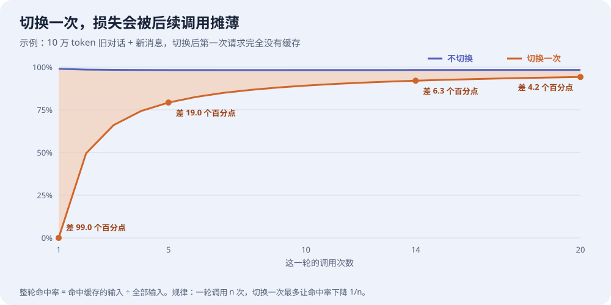
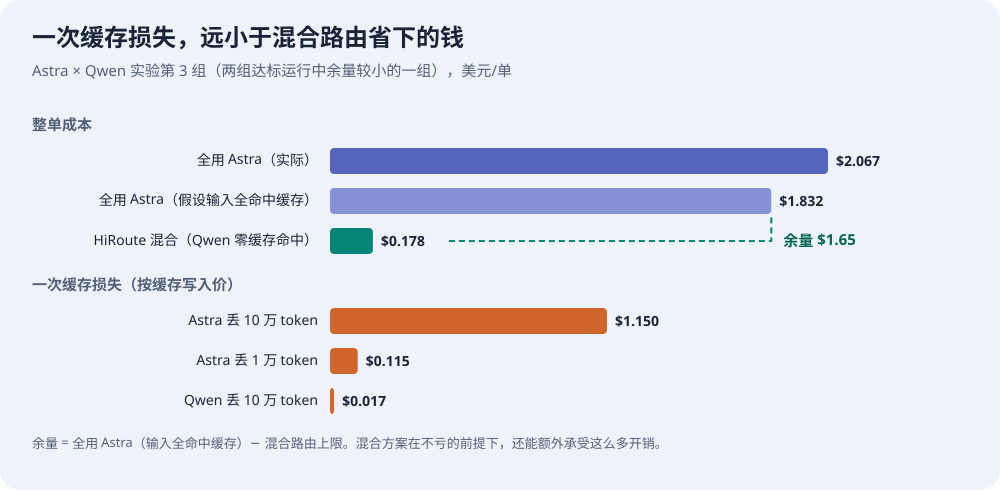
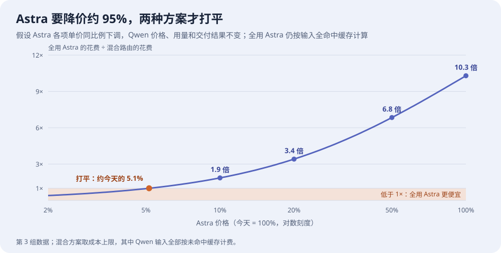

# 切换模型会丢缓存，智能路由还省钱吗？

智能路由会把不同的工作交给不同的模型。很多人随之会问：模型一换，之前积累的缓存就用不上了，这笔损失会不会把省下的钱又花回去？

**简短回答：会损失一些，但远远抵不掉省下的钱。**

- **切换本来就不多。** HiRoute 在同一轮任务的连续工具调用中不换模型，只在用户发来新消息、上下文压缩这类节点重新选择。
- **损失只有一次，会被摊薄。** 缓存损失只发生在切换后的第一次请求，后续调用又能用上缓存。
- **往便宜的模型切，旧上下文反而更省钱。** 便宜模型从头处理一遍，常常比贵模型读缓存还便宜。
- **整单余量很大。** 在 Astra × Qwen 实验中，即使假设全用 Astra 时输入全部命中缓存，混合路由每单仍便宜约 90%；Astra 要降价约 95%，两种方案才打平。

这些开销由 HiRoute 在切换节点上控制，使用智能省钱不需要自己先算一遍账。下面逐条说明。

## 先弄清楚：缓存省的是什么钱

Agent 每次调用模型，都要把整段对话历史重新发一遍，包括系统提示词、工具定义、之前的消息和工具结果。对话越长，每次重复发送的内容就越多。

KV Cache 让模型记住已经处理过的开头部分，下文称为“前缀”。下一次请求的开头相同，就可以直接读取缓存，按缓存读取价计费，通常只有普通输入价的十分之一左右。

缓存是跟着模型走的。换到一个没处理过这段历史的模型，它只能从头处理一遍，之后的请求才能读取它自己的缓存。所以切换的缓存损失是：**本来能按缓存价读取的那段前缀，在新模型上要按全价重新处理一次。** 这是一次性费用，不会在之后每次调用中重复发生。

## HiRoute 怎么减少切换

HiRoute 的上下文保持机制（ContextHold）按照对话的节奏决定何时可以换模型：

| 什么时候 | HiRoute 怎么做 | 对缓存的影响 |
| --- | --- | --- |
| 同一轮里连续的工具调用 | 沿用本轮已经做出的选择，继续使用当前模型 | 不切换，缓存随对话增长持续复用 |
| 用户发来新消息 | 重新判断任务，可能继续，也可能更换 | 继续就没有损失；更换则损失一次旧前缀 |
| 上下文压缩或重建后 | 原选择仍适用就保持，否则重新判断 | 历史本来就要部分重建，换模型的额外损失更小 |

一轮任务中的大多数调用是工具往返，这部分不会换模型。在一次 40 次请求的无人值守编码实验中，有 35 次直接沿用了已有选择，占 87.5%。

实际能否命中缓存，还取决于模型服务商的缓存规则和有效期；当前模型不可用时，也会自动接力到备用模型。具体规则见[模型路由指南](https://hiroute.ai/docs/model-routing/)。

## 切换一次，损失会被后续调用摊薄

设想这样一个场景：你和 Agent 的对话已经积累了 10 万 token，这时你发了一条新消息，路由决定换一个模型。

- **切换后的第一次请求：** 10 万 token 都要重新处理，这次请求的缓存命中率从 99% 降到 0。单看这一次，损失很大。
- **之后的工具调用：** 新模型已经缓存了这段对话，命中情况和不切换时一样。

一轮调用越多，这次损失摊得越薄：**一轮调用 n 次，切换一次造成的整轮命中率下降不超过 1/n。** 从实验记录看，写稿、审稿类任务一轮平均约 7 次调用，长时间编码任务可以连续十几次。

需要留意的是对话很长、每轮只有一两次调用、又频繁换模型的情况，这时损失摊不开。HiRoute 只在新消息和压缩等节点重新选择，正是为了避免这种来回切换。

## 压缩之后再切换，损失更小

上下文太长时，Agent 会把早期历史压缩成摘要。压缩之后，即使不换模型，摘要和后续内容也要重新处理。还能继续命中缓存的，通常只剩系统提示词、工具定义这类没有变化的部分（参见 Claude 的[压缩与缓存说明](https://platform.claude.com/docs/en/build-with-claude/compaction-threshold#maximizing-cache-hits-with-system-prompts)）。

所以在压缩节点换模型，额外损失的只是这段剩余前缀，而不是整段历史。**连续执行减少切换的次数，在压缩节点切换则减少每次损失的大小。**

## 换算成钱：一次损失多少

下面使用 Astra × Qwen 实验冻结的价格，单位为美元/百万 token。Qwen 原价以人民币计，已按固定汇率折算：

| 每百万 token | Astra | Qwen 3.8 Flash |
| --- | ---: | ---: |
| 普通输入 | 10 | 约 0.12 |
| 缓存读取 | 1 | 约 0.015 |
| 缓存写入 | 12.5 | 约 0.19 |
| 输出 | 50 | 约 0.40 |

按偏贵的方式估算，丢失一次缓存多花的钱是：

- **Astra 丢掉 10 万 token：** 约 **1.15 美元**。
- **Astra 丢掉 1 万 token**（例如压缩后只剩系统提示词和工具定义）：约 **0.115 美元**。
- **Qwen 丢掉 10 万 token：** 不到 **2 美分**。

这笔费用只付一次。长前缀的缓存确实值钱，这也是 HiRoute 尽量保持连续执行的原因。

### 往便宜的模型切，账反而更好看

真正换模型时，还要算上两个模型本身的价差。同样是 10 万 token 的旧前缀：

| 切换方向 | 不切换：原模型读缓存 | 切换：新模型重新处理 | 结果 |
| --- | ---: | ---: | --- |
| Astra → Qwen | 0.10 美元 | 约 0.019 美元 | **反而省下约 0.08 美元** |
| Qwen → Astra | 约 0.0015 美元 | 1.25 美元 | 多花约 1.25 美元 |

**智能路由省钱，主要靠把工作交给便宜模型，而在这个方向上，缓存损失几乎可以忽略；升级到 Astra，则是为更强的能力付费。**

## 放回整单：省下的钱远多于缓存开销

最终要看的是整个任务的总账。在 [Astra × Qwen 实验](https://hiroute.ai/news/astra-qwen-smart-routing/)中，Qwen 负责六份资料核验，Astra 负责关键决策，并与全程只用 Astra 的方案对比。三组配对运行中，有两组的两种方案都达到了验收标准；另一组未达标的结果也完整保留在[实验说明](../experiments/cases/research-cost-quality/README.md)中。

| 两种方案都达标的运行 | 混合路由 | 全用 Astra | 节省 |
| --- | ---: | ---: | ---: |
| 第 2 组 | 约 0.147 美元 | 约 1.84 美元 | 92% |
| 第 3 组 | 约 0.178 美元 | 约 2.07 美元 | 91% |

再给全用 Astra 一个最理想的条件：假设它的输入全部命中缓存，而混合路由里的 Qwen 一次缓存都没命中。即便如此，混合路由每单仍便宜约 90%，还剩约 1.65 美元的余量。缓存再好，也只能降低输入费用，省不了输出费用。

一次丢失 1 万 token 的 Astra 缓存，只占这份余量的约 7%；整份余量大约相当于再重建 14 万 token 的 Astra 缓存。

## 主力模型降价了，还划算吗？

主力模型降价很常见。假设 Astra 的各项单价按同一比例下调，其他条件不变：

Astra 降价一半，全用 Astra 仍是混合路由的约 6.8 倍；降价 80%，仍是约 3.4 倍。**要降价约 95%，两种方案才打平。** 而且这已经是对全用 Astra 最有利的算法。

## 结论：便宜模型持续干活，需要时再升级

HiRoute 的目标，是让适合经济模型的工作尽量由经济模型持续完成，任务需要更强能力时再交给主力模型。复杂任务可以一开始就用主力模型；经济模型表现不足时也可以升级，避免为了省单次调用的费用而反复返工。

- **阶段内保持模型稳定**，持续积累缓存收益；
- **在压缩等重建节点重新判断**，减少可以避免的缓存损失；
- **必要时升级能力**，守住交付标准。

缓存损失是一次性的、有上限的小额开销，切换节点也由 HiRoute 控制。**把适合的工作交给明显更便宜的模型，省下的钱远多于缓存重建、路由判断和返工的开销。** 在上面的实验中，这个差距大约是一个数量级。
